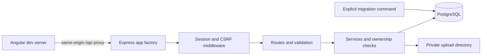

# Current backend integration

Only server.js starts listening. Tests create an app with an isolated PostgreSQL
schema. Image files are served through authorized API reads, never a public
static directory. M5 still needs to supply deployment proxy/container/volume
configuration and test durable data across container restarts.

M4 viewing/community routers use the same session and role middleware. Viewing
decisions lock the request; new requests lock and recheck the property and owner.
History and moderation audit writes share the mutation transaction. Confirmation
updates the existing freshness columns; public queries enforce non-null expiry.
