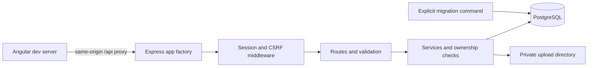

# Current backend integration

Only server.js starts listening. Tests create an app with an isolated PostgreSQL
schema. Image files are served through authorized API reads, never a public
static directory. M5 still needs to supply deployment proxy/container/volume
configuration and test durable data across container restarts.
