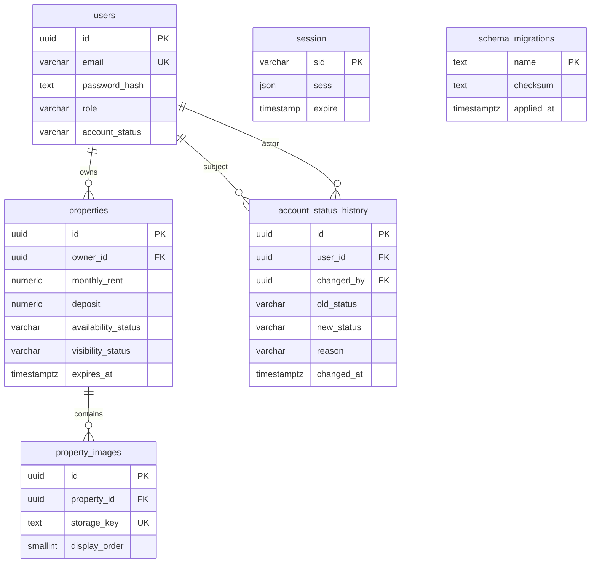

# Current M3 schema

The session adapter stores userId in server-side JSON; this is not a SQL foreign
key. account_status_history records old/new status, actor, reason and time.
M4's future tables reference users/properties via UUIDs. No M4 business tables
or endpoints are implemented by this slice.
