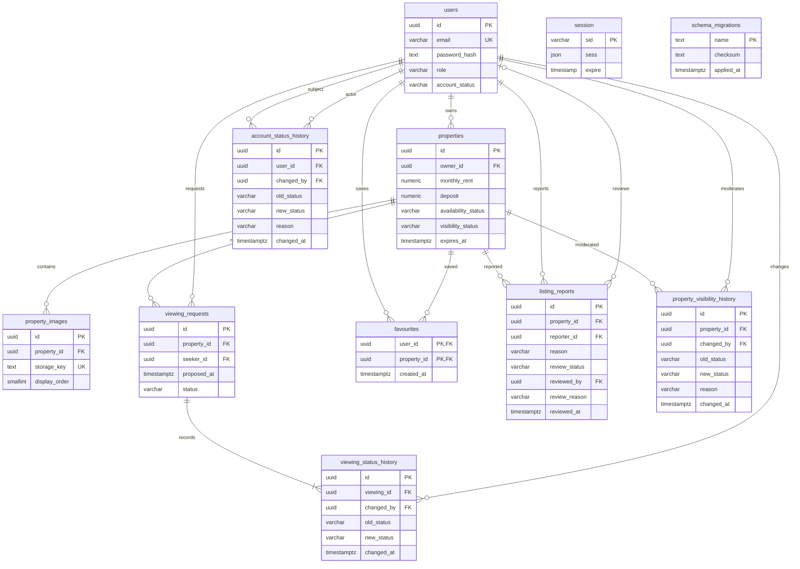

# Current M3 + M4 schema

The session adapter stores userId in server-side JSON; this is not a SQL foreign
key. account_status_history records old/new status, actor, reason and time.
M4 tables reference existing users/properties via UUIDs. Migrations 0005/0006 add
viewings/history, favourites, reports and a durable moderation audit. Pending
reports have a partial unique index on reporter/property. No original migration
was modified. See ADR 0002 for lifecycle and renewal choices pending team review.
